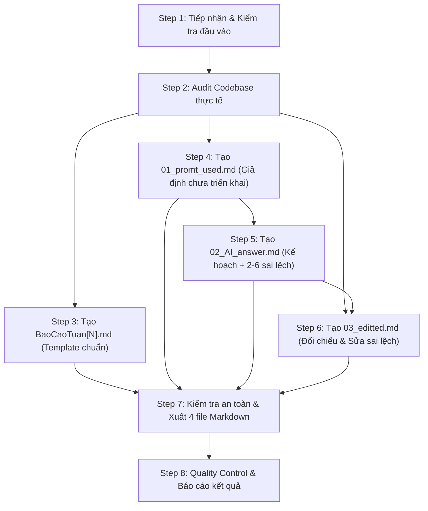

# smp-newWeeklyReport

Mục đích: Tự động hóa toàn bộ quy trình viết báo cáo tiến độ hằng tuần cho dự án SmartSpace. Dựa trên tên tuần và danh sách các chức năng do người dùng cung cấp, AI Agent tự động audit mã nguồn thực tế, đối chiếu kiến trúc, xây dựng prompt yêu cầu, lập kế hoạch giả định và chỉnh sửa các sai lệch kỹ thuật, xuất ra đủ 4 file Markdown chuẩn mẫu.

---

## Dependencies (Quy tắc phải tuân thủ)

- [Shared Workflow](../../rules/shared-workflow.md)
- [Shared Reporting Rules](../../rules/shared-reporting-rules.md)
- [Shared Architecture Rules](../../rules/shared-architecture-rules.md)
- [Shared UI & Localization Rules](../../rules/shared-ui-l10n-rules.md)
- [Design Taste Skill](../design-taste-frontend/SKILL.md) (Áp dụng khi audit hoặc mô tả các chức năng UI/Frontend)
- [smp-newFeature](../smp-newFeature/SKILL.md) (Tham chiếu quy chuẩn lập Implementation Plan cho file 02)

---

## 1. Cấu trúc đầu vào & Quy tắc tiếp nhận

### 1.1. Cách gọi lệnh
Người dùng kích hoạt skill bằng lệnh:
`/smp-newWeeklyReport`

Sau đó cung cấp tên tuần và danh sách các chức năng cần báo cáo.

### 1.2. Mẫu đầu vào hợp lệ
```text
Tuần 8:
- Triển khai tính năng xem và đăng tải tin tức cho admin.
- Cải thiện giao diện trang chủ và tạo phản ánh của app client.
- Bổ sung cơ chế gửi thông báo qua WebSocket và Firebase khi ở gần phản ánh.
```

### 1.3. Quy tắc kiểm tra đầu vào (Input Validation)
1. **Kiểm tra tính đầy đủ:** Nếu thiếu tên tuần (ví dụ chỉ nhập danh sách tính năng) hoặc thiếu danh sách tính năng, Agent **MUST** dừng lại và yêu cầu người dùng bổ sung đầy đủ trước khi thực hiện.
2. **Không tự suy đoán:** Tuyệt đối không tự ý bổ sung hoặc suy đoán các chức năng không nằm trong danh sách người dùng đã cung cấp.
3. **Bảo toàn phạm vi:** Giữ nguyên ý nghĩa, bản chất và phạm vi của từng chức năng do người dùng nhập.
4. **Chuẩn hóa văn phong:** Được phép biên tập lại câu chữ cho gãy gọn, đúng văn phong báo cáo học thuật và thuật ngữ kỹ thuật, nhưng **TUYỆT ĐỐI KHÔNG ĐƯỢC MỞ RỘNG PHẠM VI CÔNG VIỆC**.

---

## 2. Ma trận nguồn dữ liệu & Giả định cốt lõi giữa 4 file

Để tránh nhầm lẫn dữ liệu giữa các file, Agent **MUST** tuân thủ nghiêm ngặt ma trận nguồn dữ liệu sau:

| File | Giả định cốt lõi | Nguồn dữ liệu sử dụng | Mục đích & Đặc thù kỹ thuật |
| :--- | :--- | :--- | :--- |
| **`BaoCaoTuan[N].md`** | Tính năng **ĐÃ/ĐANG TRIỂN KHAI** trong thực tế | Kết quả Audit trực tiếp từ Codebase | Phản ánh trung thực 100% hiện trạng code: Hoàn thiện / Một phần / Chưa triển khai. Cột "Người phụ trách" **MUST để trống**. Cột "Tiến độ" tính theo % thực tế audit. Tuyệt đối **KHÔNG** dùng sai lệch từ file 02. |
| **`01_promt_used.md`** | Mặc định tất cả chức năng **CHƯA ĐƯỢC TRIỂN KHAI** | Góc nhìn yêu cầu sản phẩm của Khách hàng / PO | Đóng vai khách hàng mô tả bài toán và yêu cầu tính năng cho AI Agent. **TUYỆT ĐỐI KHÔNG** chứa chi tiết code (tên file, class, method, API endpoint, hex color, l10n key, DB table/column). |
| **`02_AI_answer.md`** | Mặc định tất cả chức năng **CHƯA ĐƯỢC TRIỂN KHAI** | Kiến trúc SmartSpace + **Cố ý tạo 2–6 sai lệch hợp lý** | Đóng vai AI Agent phản hồi prompt ở file 01 bằng Implementation Plan (theo `/smp-newFeature`). Kế hoạch bám sát kiến trúc thật nhưng **CỐ Ý ĐƯA VÀO 2–6 SAI LỆCH HỢP LÝ** về logic/chu kỳ/trình tự. Không tiết lộ việc cố ý viết sai. |
| **`03_editted.md`** | Đối chiếu kế hoạch với **CODE THỰC TẾ** | So khớp file `02_AI_answer.md` với Codebase | Đóng vai Tech Lead / Developer đối chiếu và sửa lại đúng các sai lệch trong file 02 theo mã nguồn thật. Trình bày dạng bullet points ngắn gọn chuẩn template. |

---

## 3. Quy trình thực hiện chi tiết (Workflow 7 bước)



---

### Step 1 — Tiếp nhận & Kiểm tra đầu vào (Validate Input)
1. Trích xuất số tuần $N$ từ chuỗi người dùng nhập (ví dụ: `tuần 8` -> `8`, tạo tiền tố `BaoCaoTuan8`).
2. Trích xuất danh sách chức năng thành các hạng mục độc lập.
3. Nếu thiếu thông tin tuần hoặc chức năng, lập tức phản hồi yêu cầu người dùng cung cấp thêm.
4. Chuẩn hóa tên các tính năng về mặt câu chữ học thuật nhưng không làm thay đổi bản chất nghiệp vụ.

---

### Step 2 — Audit Codebase thực tế (Codebase Audit)

Trước khi viết bất kỳ file nào, Agent **MUST** tiến hành audit mã nguồn thực tế cho toàn bộ danh sách chức năng được cung cấp.

#### 1. Phạm vi kiểm tra mã nguồn:
- **Frontend (`smartspace_client`, `smartspace_admin`, `smartspace_staff`):**
  - Màn hình (Screens), Components, Widgets.
  - Routing: Kiểm tra hệ thống 3-file (`route_name.dart`, `router_path.dart`, `app_router.dart`).
  - State Management & Controller / Service client.
  - UI/UX: Hỗ trợ Dark Mode / Light Mode, Design tokens theo `DESIGN.md`, các tiêu chí chống rập khuôn theo `design-taste-frontend`.
  - Localization: `app_vi.arb`, `app_en.arb` (tuyệt đối không hardcode text).
- **Backend (`SmartSpace_Backend`):**
  - Controller, API Endpoints, Request/Response DTOs.
  - Service Layer, Business Logic, Validation rules.
  - Repository, Entity, CSDL (Liquibase/Flyway migrations hoặc DDL).
  - Đa ngôn ngữ Backend: Lấy ngôn ngữ người dùng từ `users.language`, nạp message qua `MessageSource` (`messages_vi.properties`, `messages_en.properties`).
- **Realtime & Background Services:**
  - WebSocket (STOMP topic `/topic/...`, queue `/user/queue/notifications`).
  - Firebase Cloud Messaging (FCM Push Notifications).
- **Tích hợp liên ứng dụng (Multi-app integration):**
  - Sự đồng bộ và tương tác dữ liệu giữa Client, Admin và Staff.
- **Trạng thái giao diện và luồng biên:**
  - Loading state, Empty state, Error handling, Exception flow.

#### 2. Bảy (7) nguyên tắc Audit nghiêm ngặt:
1. **Phải đọc code thực tế:** Không chỉ nhìn tên file, tên class hoặc comment. Phải đọc logic triển khai bên trong.
2. **Minh chứng rõ ràng:** Mỗi kết luận về tính năng đã hoàn thiện phải kèm theo bằng chứng cụ thể từ code (file path, hàm, flow dữ liệu).
3. **Phân loại chính xác 3 trạng thái:**
   - *Hoàn thiện (Completed):* Đã có UI, logic, API, CSDL hoạt động đầy đủ.
   - *Triển khai một phần (In-progress / Partial):* Mới xong UI hoặc API, chưa nối luồng hoặc còn thiếu sót.
   - *Chưa triển khai (Not implemented):* Chưa có mã nguồn thực tế.
4. **Không hợp thức hóa:** Tuyệt đối không biến tính năng chưa làm hoặc làm dở dang thành hoàn thiện.
5. **Không dùng mock data:** Không tự bịa ra dữ liệu giả hoặc nghiệp vụ không tồn tại trong codebase.
6. **Không bỏ sót ứng dụng:** Kiểm tra toàn diện mọi app liên quan trong hệ thống (Client, Admin, Staff, Backend).
7. **Không suy đoán khi thiếu bằng chứng:** Nếu không tìm thấy minh chứng trong mã nguồn, phải ghi nhận là chưa xác minh được thay vì tự suy diễn.

> **Ghi chú:** Kết quả audit ở bước này là **nguồn chân lý duy nhất** cho file `BaoCaoTuan[N].md` và căn cứ đối chiếu cho file `03_editted.md`.

---

### Step 3 — Tạo file `BaoCaoTuan[N].md` (Báo cáo tiến độ tuần)

#### 1. Template bắt buộc:
`weekly_reports/templete/BaoCaoTuan7.md`. Agent **MUST** đọc toàn bộ template trước khi tạo file.

#### 2. Nguyên tắc đồng nhất cấu trúc (Structural Isomorphism):
**Cấu trúc của báo cáo mới phải giống hệt cấu trúc của template.**
- Giữ nguyên các cấp độ Heading (`#`, `##`), thứ tự các phần.
- Giữ nguyên cấu trúc bảng và tiêu đề các cột.
- Giữ nguyên định dạng thông tin chung và cách đánh số mục (`3.1`, `3.2`...).
- Chỉ thay đổi nội dung nghiệp vụ tương ứng với tuần đang báo cáo.
- **KHÔNG ĐƯỢC:** Thêm/bớt mục, đảo lộn thứ tự, thay đổi cấu trúc bảng, hoặc rút gọn báo cáo.

#### 3. Quy tắc chi tiết từng phần:

1. **Phần thông tin chung:**
   - Dòng tiêu đề: `**BÁO CÁO TIẾN ĐỘ**`
   - Dòng tuần: `**TUẦN [N]: [Thời gian nếu có căn cứ, nếu không thì ghi TUẦN [N]]**`
   - Bảng thông tin:
     ```markdown
     | **Tên đề tài** | Tìm hiểu công nghệ WebSocket và xây dựng hệ thống Smart Space |
     | --- | --- |
     | **GVHD** | ThS. Nguyễn Hữu Trung |
     | **Sinh viên thực hiện** | Trương Hoài Chương MSSV: 23110081 <br> Phan Phúc Hậu MSSV: 23110097 |
     | **Phạm vi báo cáo** | [Tổng hợp ngắn gọn phạm vi từ danh sách chức năng tuần N] |
     ```
2. **# Mục tiêu tuần [N]:**
   - Viết đoạn văn tổng quát về mục tiêu của tuần dựa trên danh sách chức năng.
   - Sử dụng văn phong học thuật, rõ ràng, cô đọng.
3. **# Nội dung cần thực hiện:**
   - Danh sách gạch đầu dòng liệt kê đúng các chức năng người dùng cung cấp (được trau chuốt câu chữ).
4. **# Công việc đã thực hiện:**
   - Dòng mở đầu: `**Kết quả tuần [N]:** Hoàn thành các hạng mục cơ bản được liệt kê trong mục 2. Nội dung cần thực hiện.`
   - Bảng tiến độ tổng quan:
     ```markdown
     | **STT** | **Công việc** | **Người phụ trách** | **Tiến độ** |
     | --- | --- | --- | --- |
     | 1 | [Tên công việc 1] | | [Tiến độ % thực tế] |
     | 2 | [Tên công việc 2] | | [Tiến độ % thực tế] |
     ```
     - **Cột "Người phụ trách":** **BẮT BUỘC ĐỂ TRỐNG** để người dùng tự phân công thủ công.
     - **Cột "Tiến độ":** Phản ánh đúng kết quả audit thực tế (ví dụ: `100%`, `80%`, `50%`), **KHÔNG mặc định 100%**.
5. **Từ mục `## 3.1.` trở đi:**
   - Mỗi mục con tương ứng với một chức năng trong danh sách.
   - Tiêu đề mục: `## 3.[k]. [Tên chức năng k]`.
   - Nội dung mô tả chi tiết những gì **thực tế đã triển khai và hoàn thiện**, chia thành các gạch đầu dòng:
     - Setup folder, module, package.
     - Giao diện UI (danh sách, chi tiết, form nhập, component...).
     - Backend API (endpoints, controller, service, repository, entity/DTO).
     - Realtime (WebSocket STOMP channel, Firebase FCM notification).
     - Cơ chế đồng bộ, validation, xử lý luồng nghiệp vụ.
   - **Chỉ đưa vào các nội dung có minh chứng từ code thực tế.**
   - **Tuyệt đối KHÔNG đưa các nội dung sai lệch từ file 02 vào báo cáo tuần.**

---

### Step 4 — Tạo file `01_promt_used.md` (Prompt yêu cầu triển khai)

#### 1. Template bắt buộc:
`weekly_reports/templete/01_promt_used.md`. Agent **MUST** đọc template trước khi viết.

#### 2. Giả định bắt buộc:
Mặc định xem tất cả các chức năng trong danh sách đầu vào là **CHƯA ĐƯỢC TRIỂN KHAI**. Tuyệt đối không dùng kết quả audit để thay đổi giả định này.

#### 3. Vai trò & Góc nhìn:
Đóng vai **Khách hàng / Product Owner** đưa ra yêu cầu sản phẩm chi tiết cho AI Agent thực hiện triển khai (kích hoạt bằng lệnh `/smp-newFeature`).

#### 4. Cấu trúc nội dung chuẩn:
```markdown
Tiến hành /smp-newFeature để thực hiện các công việc sau:
- [Tên tóm tắt chức năng 1]
- [Tên tóm tắt chức năng 2]
- [Tên tóm tắt chức năng 3]

Cụ thể:
1. [Tên chức năng 1]:
	- [Mô tả chi tiết mục tiêu, bài toán cần giải quyết, hành vi người dùng, kết quả mong đợi, giao diện, trạng thái loading/empty/error, tương tác...]

2. [Tên chức năng 2]:
	- [Mô tả chi tiết yêu cầu nghiệp vụ, logic hệ thống, thông báo, tích hợp giữa các app...]
```

#### 5. BẢNG NGUYÊN TẮC CẤM KỴ (Strict Prohibitions):

| Yếu tố | QUY TẮC CẤM TUYỆT ĐỐI (KHÔNG ĐƯỢC DÙNG) | Cách diễn đạt ĐƯỢC PHÉP thay thế |
| :--- | :--- | :--- |
| **Tên file** | `create_report_screen.dart`, `ReportController.java` | "màn hình tạo phản ánh", "bộ xử lý API phía backend" |
| **Tên class/hàm/biến** | `ReportServiceImpl`, `proximityCheck()`, `isSubmitting` | "nghiệp vụ kiểm tra khoảng cách", "trạng thái đang gửi" |
| **Endpoint URL** | `POST /reports/proximity-check`, `/api/v1/auth/login` | "API kiểm tra lân cận", "cơ chế đăng nhập qua API" |
| **Mã màu sắc** | `#00796B`, `#558B2F`, `Colors.teal` | "tông màu xanh thương hiệu", "màu sắc theo theme hệ thống" |
| **Localization key** | `app_vi.arb`, `home_title`, `btn_submit` | "hỗ trợ đa ngôn ngữ", "nhãn hiển thị chuẩn hóa" |
| **CSDL table/col** | `users.language`, bảng `reports`, cột `status` | "lưu trữ vào CSDL", "thuộc tính trạng thái của phản ánh" |
| **Code snippets** | Không viết bất kỳ đoạn code Dart, Java, SQL, JSON nào | Diễn giải bằng văn bản mô tả luồng và hành vi |
| **Đường dẫn thư mục** | `smartspace_client/lib/features/...` | "ứng dụng Client", "phía Admin", "phía Staff" |

> **Thuật ngữ kỹ thuật tổng quan ĐƯỢC PHÉP dùng:** `context.push`, `context.go`, Controller, Service, Repository, Data Layer, UI Layer, Web View, Mobile View, WebSocket, Firebase, API, Database, Haversine, Mapbox, Timer.

Prompt phải đủ chi tiết, rõ ràng để một AI Agent khác đọc vào là có thể hiểu trọn vẹn yêu cầu và bắt đầu triển khai mà không cần hỏi lại.

---

### Step 5 — Tạo file `02_AI_answer.md` (Kế hoạch AI Agent với sai lệch hợp lý)

#### 1. Template bắt buộc:
`weekly_reports/templete/02_AI_answer.md`. Agent **MUST** đọc template trước khi viết.

#### 2. Giả định bắt buộc:
Mặc định xem tất cả chức năng là **CHƯA ĐƯỢC TRIỂN KHAI**.

#### 3. Vai trò & Phong cách:
Đóng vai **AI Agent** tiếp nhận prompt từ file `01_promt_used.md` và phản hồi bằng một **Implementation Plan** chi tiết theo quy trình chuẩn của `/smp-newFeature`.
- Kế hoạch phải bám sát kiến trúc thực tế của SmartSpace:
  - Frontend: Routing 3-file (`route_name.dart`, `router_path.dart`, `app_router.dart`), Dark/Light mode theo `design.md`, chống AI-slop theo Taste skill, L10n (`app_vi.arb`, `app_en.arb`).
  - Backend: Spring Boot kiến trúc phân lớp Controller - Service - Repository, DTO, WebSocket STOMP, FCM, đa ngôn ngữ qua `User.getLanguage()` và `MessageSource`.

#### 4. Cấu trúc trình bày:
Chia theo từng chức năng trong prompt:
```markdown
## [k]. [Tên chức năng k]
### Mục tiêu & Phân tích (hoặc Mục tiêu & Flow dữ liệu / Mục tiêu & Giải thuật)
- Phân tích mục tiêu, luồng tương tác, kiến trúc liên quan.

### Kế hoạch thực hiện:
- **Files tạo mới / cập nhật:** Liệt kê các file chính (ở mức tổng quan, không cần liệt kê toàn bộ).
- **Frontend / Client / Staff / Admin:** Luồng UI, routing, controller.
- **Backend / Realtime:** API, Service, WebSocket, FCM push notification.
- **L10n / UI Design:** Localization keys, tuân thủ Light/Dark mode.
```
*Lưu ý: Không viết mã nguồn chi tiết, không viết full code implementation. Độ dài vừa phải, súc tích.*

#### 5. CƠ CHẾ CỐ Ý TẠO SAI LỆCH KỸ THUẬT HỢP LÝ (Deliberate Discrepancies):
Đây là **yêu cầu bắt buộc và đặc thù** của file 02:
- Agent **MUST** cố ý đưa vào từ **2 đến 6 điểm sai lệch kỹ thuật** xuyên suốt toàn bộ kế hoạch.
- **Mục đích:** Tạo cơ sở dữ liệu đối chiếu và chỉnh sửa cho file `03_editted.md`.
- **Tiêu chuẩn của điểm sai lệch:**
  1. *Có tính thực tế cao:* Nghe rất logic, có vẻ như một giải pháp thiết kế khả thi.
  2. *Không ngớ ngẩn / vô lý:* Không viết sai theo kiểu lỗi chính tả ngớ ngẩn hoặc cú pháp hỏng hóc.
  3. *Không phá vỡ bản chất tính năng:* Không biến tính năng A thành tính năng hoàn toàn khác.
  4. *Có thể đối chiếu với code thật:* Phải có điểm khác biệt rõ ràng so với implementation thực tế trong codebase.
- **Các dạng sai lệch gợi ý:**
  - *Chu kỳ thời gian / Tần suất:* Code thực tế chạy 30 phút/lần hoặc khi refresh, kế hoạch ghi 15 phút/lần cố định.
  - *Điều kiện nghiệp vụ / Ngưỡng số liệu:* Khoảng cách kích hoạt thông báo (50m vs 100m), kích thước vùng đệm pixel (32px vs 48px).
  - *Trình tự thực thi luồng:* Điều hướng trang trước hay sau khi bắn socket; gọi API trước hay phát event FCM trước.
  - *Cơ chế thông báo / Kênh truyền:* Kế hoạch ghi chỉ gửi WebSocket, thực tế code gửi cả WebSocket và FCM; hoặc ngược lại.
  - *Cập nhật trạng thái / Cache:* Kế hoạch chỉ lưu vào DB rồi chuyển trang, thực tế code có cập nhật cache/state local và làm mới danh sách trang chủ.
  - *Phạm vi áp dụng:* Kế hoạch chỉ tính toán cho mobile, code thực tế hỗ trợ cả Web Admin.
- **Phân bổ số lượng:** Tổng cộng có khoảng **2–6 sai lệch** trên toàn bộ file 02 (tùy số lượng và độ phức tạp của chức năng).
- **RÀNG BUỘC TUYỆT ĐỐI:**
  - **KHÔNG ĐƯỢC** tiết lộ trong file 02 rằng các điểm này là cố ý viết sai.
  - **KHÔNG ĐƯỢC** dùng các điểm sai lệch này vào file `BaoCaoTuan[N].md`.
  - Agent ghi nhận danh sách các điểm sai lệch này vào bộ nhớ nội bộ để thực hiện Step 6.

---

### Step 6 — Tạo file `03_editted.md` (Đối chiếu & Sửa sai lệch)

#### 1. Template bắt buộc:
`weekly_reports/templete/03_editted.md`. Agent **MUST** đọc template trước khi viết.

#### 2. Vai trò & Nhiệm vụ:
Đóng vai **Tech Lead / Code Reviewer** đối chiếu Implementation Plan trong file `02_AI_answer.md` với **Codebase thực tế** đã audit tại Step 2, phát hiện toàn bộ các điểm sai lệch được cố ý tạo ra và đưa ra các chỉnh sửa chính xác.

#### 3. Cấu trúc trình bày:
Trình bày dưới dạng các gạch đầu dòng (`-`) súc tích, trực diện đúng theo template mẫu:
```markdown
- [Nội dung chỉnh sửa cho sai lệch 1: mô tả chính xác yêu cầu/cơ chế thực tế theo code]
- [Nội dung chỉnh sửa cho sai lệch 2: bổ sung luồng hoặc điều chỉnh logic theo code]
- [Nội dung chỉnh sửa cho sai lệch 3: chuẩn hóa điều kiện hoặc phạm vi áp dụng theo code]
```

#### 4. Quy tắc bắt buộc:
1. **Chỉ sửa điểm sai:** Chỉ tập trung chỉnh sửa đúng các điểm có sai lệch giữa file 02 và code thực tế.
2. **Không sửa file 02:** Giữ nguyên vẹn file `02_AI_answer.md`, không thay đổi nội dung file đó.
3. **Không viết lại cả kế hoạch:** Tuyệt đối không viết lại toàn bộ kế hoạch của file 02 bằng cách diễn đạt khác.
4. **Không bịa tính năng mới:** Không tự ý bổ sung các tính năng nằm ngoài phạm vi tuần báo cáo.
5. **Giữ nguyên điểm đúng:** Những nội dung trong file 02 vốn đã đúng theo kiến trúc thì không nhắc lại.
6. **Căn cứ từ mã nguồn thực tế:** Mọi nội dung chỉnh sửa phải phản ánh chính xác 100% mã nguồn đang chạy trong dự án.

---

### Step 7 — Kiểm tra an toàn & Xuất 4 file Markdown

#### 1. Quy ước thư mục đầu ra:
Tất cả các báo cáo phải được lưu trong thư mục `weekly_reports/` theo quy ước:
`weekly_reports/BaoCaoTuan[N]/` (ví dụ: `weekly_reports/BaoCaoTuan8/`).

Cấu trúc thư mục đầu ra bắt buộc:
```text
weekly_reports/
├── templete/
│   ├── BaoCaoTuan7.md
│   ├── 01_promt_used.md
│   ├── 02_AI_answer.md
│   └── 03_editted.md
│
└── BaoCaoTuan[N]/
    ├── BaoCaoTuan[N].md
    ├── 01_promt_used.md
    ├── 02_AI_answer.md
    └── 03_editted.md
```

#### 2. Quy tắc an toàn chống ghi đè (Overwrite Protection):
- Trước khi tạo file, Agent **MUST** kiểm tra xem thư mục `weekly_reports/BaoCaoTuan[N]/` hoặc các file trong đó đã tồn tại hay chưa.
- **Nếu đã tồn tại:** Agent **MUST DỪNG LẠI VÀ HỎI Ý KIẾN NGƯỜI DÙNG** trước khi ghi đè hoặc thay thế. Tuyệt đối không tự ý xóa hoặc ghi đè báo cáo tuần cũ.
- **Nếu chưa tồn tại:** Tự động tạo thư mục và ghi đủ 4 file Markdown hoàn chỉnh.

---

### Step 8 — Quality Control (QC Checklist) & Báo cáo kết quả

Trước khi hoàn thành nhiệm vụ, Agent **MUST** thực hiện kiểm tra chéo theo bảng tiêu chí sau:

| File / Hạng mục | Tiêu chí kiểm tra bắt buộc | Đạt / Không đạt |
| :--- | :--- | :---: |
| **`BaoCaoTuan[N].md`** | 1. Cấu trúc, heading, bảng, thứ tự giống 100% `BaoCaoTuan7.md`.<br>2. Cột "Người phụ trách" hoàn toàn **ĐỂ TRỐNG**.<br>3. Cột "Tiến độ" phản ánh đúng kết quả audit thực tế (không mặc định 100%).<br>4. Chi tiết từ mục 3.1 có minh chứng từ code thực tế.<br>5. Không chứa bất kỳ nội dung sai lệch nào từ file 02. | [ ] |
| **`01_promt_used.md`** | 1. Mặc định toàn bộ tính năng **CHƯA ĐƯỢC TRIỂN KHAI**.<br>2. Viết dưới góc nhìn yêu cầu sản phẩm của khách hàng/PO.<br>3. **KHÔNG** chứa tên file, class, method, endpoint URL, hex color, l10n key, DB table/col, code snippet.<br>4. Bao quát toàn bộ tính năng người dùng cung cấp. | [ ] |
| **`02_AI_answer.md`** | 1. Mặc định toàn bộ tính năng **CHƯA ĐƯỢC TRIỂN KHAI**.<br>2. Kế hoạch bám sát kiến trúc SmartSpace (Client/Admin/Staff, Spring Boot, WebSocket, FCM, L10n, Design tokens).<br>3. Cố ý tạo đúng từ **2 đến 6 sai lệch kỹ thuật hợp lý**.<br>4. Không tiết lộ việc cố ý tạo sai lệch trong nội dung file. | [ ] |
| **`03_editted.md`** | 1. Sửa toàn bộ các điểm sai lệch trong file 02 về đúng với code thực tế.<br>2. Không thay đổi file 02 gốc.<br>3. Giữ nguyên các nội dung đúng, không viết lại toàn bộ kế hoạch.<br>4. Trình bày bullet points chuẩn theo template mẫu. | [ ] |
| **Hệ thống & File** | 1. Cú pháp Markdown chuẩn xác, bảng biểu render đúng.<br>2. Văn phong tiếng Việt học thuật, chuyên nghiệp, súc tích.<br>3. Đúng đường dẫn `weekly_reports/BaoCaoTuan[N]/`.<br>4. Không làm thay đổi các file template gốc trong `weekly_reports/templete/`. | [ ] |

---

## 4. Các quy tắc cấm kỵ (Strict Anti-patterns)

1. **CẤM Audit sơ sài:** Không được đoán tính năng qua tên file. Phải mở file và đọc logic thực tế.
2. **CẤM bịa đặt tiến độ:** Không được tự ý gán 100% nếu tính năng mới làm dở dang hoặc chưa có trong code.
3. **CẤM lẫn lộn dữ liệu giữa 4 file:** Báo cáo tuần dùng code thật; File 01 và 02 mặc định chưa làm; File 03 đối chiếu sửa sai. Không được để dữ liệu bị trộn lẫn.
4. **CẤM lộ sai lệch trong file 02:** Không được viết những câu như "chúng ta sẽ cố tình làm sai...", "điểm này viết sai để file 03 sửa...".
5. **CẤM viết code thực thi bằng script riêng:** Skill này vận hành bằng hướng dẫn trực tiếp cho AI Agent thông qua các công cụ đọc/ghi file sẵn có của hệ thống, không tạo script phụ trợ không cần thiết.
6. **CẤM sửa template gốc:** Tuyệt đối không ghi đè hoặc chỉnh sửa các file trong `weekly_reports/templete/`.

---

## 5. Hướng dẫn phản hồi người dùng sau khi tạo xong

Sau khi hoàn tất việc tạo 4 file báo cáo, Agent phản hồi cho người dùng theo cấu trúc sau:
1. **Thông báo hoàn thành:** Xác nhận đã tạo đủ 4 file cho tuần $N$.
2. **Đường dẫn thư mục & Danh sách file:**
   - `weekly_reports/BaoCaoTuan[N]/BaoCaoTuan[N].md`
   - `weekly_reports/BaoCaoTuan[N]/01_promt_used.md`
   - `weekly_reports/BaoCaoTuan[N]/02_AI_answer.md`
   - `weekly_reports/BaoCaoTuan[N]/03_editted.md`
3. **Tóm tắt kết quả Audit:** Nêu ngắn gọn tiến độ thực tế (% hoàn thành) của từng tính năng đã audit trong codebase.
4. **Danh sách các điểm sai lệch kỹ thuật đã tạo và sửa đổi:** Tóm tắt ngắn gọn các điểm sai lệch hợp lý được đưa vào file 02 và nội dung đã đối chiếu sửa chữa trong file 03.
5. **Lưu ý người dùng:** Nhắc người dùng điền thông tin vào cột "Người phụ trách" trong file `BaoCaoTuan[N].md`.

