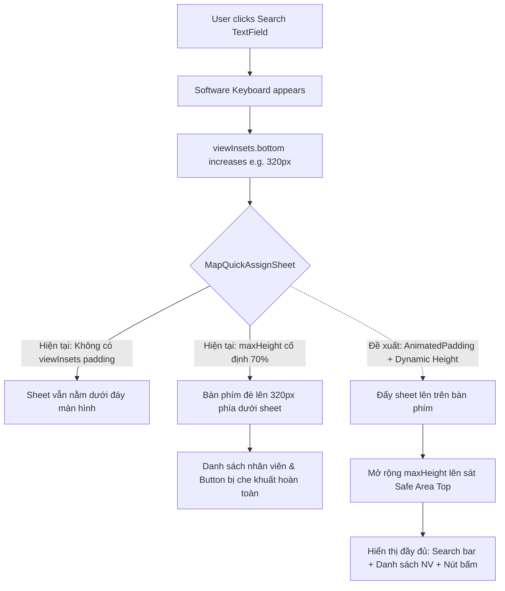

# Implementation Plan: Cải thiện UX Bottom Sheet Phân công nhanh khi Bàn phím xuất hiện

> **Quy chuẩn thực hiện theo `/smp-fixbug`**  
> Dự án: **SmartSpace Monorepo**  
> Ứng dụng: **smartspace_admin**  
> File trọng tâm: `smartspace_admin/lib/ui/screen/map/widgets/map_quick_assign_sheet.dart`

---

## 1. Tổng quan lỗi (Bug Overview)

- **Mô tả lỗi**:
  - Khi người dùng bấm vào thanh nhập tìm kiếm nhân viên trong bottom sheet "Phân công nhanh" trên bản đồ, bàn phím ảo (software keyboard) xuất hiện.
  - Hiện tại, bottom sheet giữ nguyên vị trí cố định ở đáy màn hình và không phản hồi với `viewInsets.bottom`.
  - Hậu quả: Bàn phím che lấp phần lớn hoặc toàn bộ danh sách nhân viên, khiến người dùng không thể vừa gõ tìm kiếm vừa xem kết quả lọc nhân viên theo thời gian thực.
- **Hành vi kỳ vọng (Expected Behavior)**:
  - Khi bàn phím xuất hiện, toàn bộ bottom sheet phải được đẩy lên trên bàn phím và mở rộng lên sát mép trên màn hình.
  - Người dùng có thể:
    1. Quan sát rõ ràng ô tìm kiếm và từ khóa đang nhập.
    2. Xem và cuộn mượt mà danh sách nhân viên tương ứng với từ khóa vừa gõ.
    3. Nhìn thấy các lựa chọn mức độ nghiêm trọng và nút phân công ngay trên bàn phím.
- **Mức độ nghiêm trọng**: **Medium** (ảnh hưởng trực tiếp đến hiệu quả thao tác và trải nghiệm người dùng trên thiết bị di động / tablet).

---

## 2. Phân tích Nguyên nhân cốt lõi (Root Cause Analysis)



### Chi tiết Root Causes:
1. **Thiếu xử lý `viewInsets.bottom`**:
   `MapQuickAssignSheet` được render bên trong `showModalBottomSheet(isScrollControlled: true)`. Tuy nhiên, widget không có `Padding` hoặc `AnimatedPadding` theo `MediaQuery.viewInsetsOf(context).bottom`, khiến sheet không nhận biết được khoảng đệm bàn phím.
2. **Ràng buộc chiều cao tĩnh (`maxHeight: MediaQuery.of(context).size.height * 0.7`)**:
   Khi bàn phím chiếm khoảng 35% - 45% màn hình:
   - Nếu giữ nguyên chiều cao 70% và chỉ đẩy lên, sheet sẽ bị tràn màn hình (overflow) hoặc các widget cố định (Header, Chips, Severity, Button) sẽ chiếm toàn bộ không gian còn lại.
   - `ListView` nhân viên nằm trong `Flexible` bị co lại về 0px, dẫn đến biến mất danh sách.
3. **Cần mở rộng lên đầu màn hình khi gõ phím**:
   Khoảng không gian lý tưởng nhất khi bàn phím mở là toàn bộ vùng khả dụng từ đỉnh bàn phím lên đến sát thanh trạng thái (status bar):  
   $$\text{maxHeight} = \text{screenHeight} - \text{bottomInset} - \text{topPadding} - 16\text{px}$$

---

## 3. Danh sách File bị ảnh hưởng

| Phân hệ | File | Phạm vi thay đổi |
| :--- | :--- | :--- |
| **Admin UI** | `smartspace_admin/lib/ui/screen/map/widgets/map_quick_assign_sheet.dart` | Bọc `AnimatedPadding(bottomInset)` + tính toán `maxHeight` động khi bàn phím mở/đóng; tối ưu cấu trúc cuộn. |

*(Tùy chọn mở rộng liên quan: Kiểm tra `admin_report_detail_screen.dart` - `_showStaffPickerBottomSheet` để áp dụng cơ chế tương tự nếu cần).*

---

## 4. Chi tiết Giải pháp Kỹ thuật (Proposed Fix)

### 4.1. Điều chỉnh `map_quick_assign_sheet.dart`

Thay vì Container với constraints tĩnh:
```dart
@override
Widget build(BuildContext context) {
  final l10n = AppLocalizations.of(context)!;
  final theme = Theme.of(context);
  final cs = theme.colorScheme;
  final staffsAsync = ref.watch(mapStaffListProvider);
  final assignState = ref.watch(reportAssignProvider);

  final mq = MediaQuery.of(context);
  final bottomInset = mq.viewInsets.bottom;
  final isKeyboardOpen = bottomInset > 0;
  final topPadding = mq.padding.top;

  // Khi bàn phím mở: Kéo sheet lên sát đầu màn hình (trừ safe area top)
  // Khi bàn phím đóng: Chiều cao tối đa 75% màn hình
  final maxHeight = isKeyboardOpen
      ? (mq.size.height - bottomInset - topPadding - 16)
      : (mq.size.height * 0.75);

  return AnimatedPadding(
    padding: EdgeInsets.only(bottom: bottomInset),
    duration: const Duration(milliseconds: 180),
    curve: Curves.easeOutCubic,
    child: AnimatedContainer(
      duration: const Duration(milliseconds: 180),
      curve: Curves.easeOutCubic,
      constraints: BoxConstraints(
        maxHeight: maxHeight,
      ),
      decoration: BoxDecoration(
        color: cs.surface,
        borderRadius: const BorderRadius.vertical(top: Radius.circular(24)),
      ),
      child: SafeArea(
        top: false,
        bottom: !isKeyboardOpen,
        child: Column(
          mainAxisSize: MainAxisSize.min,
          children: [
            // Handle bar
            Padding(
              padding: const EdgeInsets.only(top: 12, bottom: 4),
              child: Container(
                width: 36,
                height: 4,
                decoration: BoxDecoration(
                  color: cs.onSurfaceVariant.withValues(alpha: 0.3),
                  borderRadius: BorderRadius.circular(2),
                ),
              ),
            ),
            // Header & Report Title
            ...
            // Position Chips
            ...
            // Search Bar
            ...
            // Divider
            // Flexible Staff List (Expanded / Flexible khi có bàn phím)
            ...
            // Severity Chips & Confirm Button
            ...
          ],
        ),
      ),
    ),
  );
}
```

### 4.2. Đảm bảo tuân thủ Dark Mode / Light Mode & L10n
- Nền sheet sử dụng token `cs.surface`.
- Handle bar sử dụng `cs.onSurfaceVariant.withValues(alpha: 0.3)`.
- Toàn bộ text, hint text và button label tiếp tục sử dụng key L10n hiện có (`l10n.searchStaffHint`, `l10n.mapAssignStaff`, v.v.).
- Hiệu ứng chuyển động (Animation) sử dụng đường cong `Curves.easeOutCubic` đồng bộ với bàn phím hệ điều hành (Android / iOS).

---

## 5. Rủi ro hồi quy (Regression Risks) & Phương án kiểm soát

| Rủi ro | Mức độ | Phương án kiểm soát |
| :--- | :--- | :--- |
| **Màn hình nhỏ bị tràn (Overflow) khi bàn phím mở** | Thấp | `maxHeight` trừ chính xác `bottomInset` + `topPadding` + `16px`, danh sách nhân viên nằm trong `Flexible` nên tự động co giãn vừa vặn với khoảng trống còn lại. |
| **Bàn phím giật lag khi mở** | Rất thấp | Dùng `AnimatedPadding` với `duration: 180ms` giúp bottom sheet trượt mượt mà theo bàn phím. |
| **Mất focus ô tìm kiếm khi sheet trượt** | Không có | `TextField` nằm trong cùng widget tree, không bị unmount hay rebuild phá vỡ focus node. |

---

## 6. Kế hoạch Kiểm thử (Test Cases)

- [ ] **TC-01 (Mở sheet ban đầu)**: Mở bottom sheet phân công từ bản đồ $\rightarrow$ Chiều cao khoảng 70-75% màn hình, hiển thị đầy đủ các thành phần.
- [ ] **TC-02 (Bật bàn phím)**: Bấm vào thanh tìm kiếm $\rightarrow$ Bàn phím xuất hiện, bottom sheet mượt mà trượt lên sát mép trên màn hình.
- [ ] **TC-03 (Nhập từ khóa & xem danh sách)**:
  - Nhập tên nhân viên (ví dụ "nguyen" hoặc "lan").
  - Ô tìm kiếm hiển thị rõ ràng chữ vừa gõ.
  - Danh sách nhân viên phía trên bàn phím lọc và hiển thị ngay lập tức, cuộn lên/xuống mượt mà.
- [ ] **TC-04 (Chọn nhân viên khi bàn phím mở)**: Bấm chọn một nhân viên trong danh sách $\rightarrow$ Nhân viên được chọn (hiển thị checkmark), ô nhập không bị mất dữ liệu.
- [ ] **TC-05 (Ẩn bàn phím)**: Bấm nút back hoặc chạm ngoài để ẩn bàn phím $\rightarrow$ Bottom sheet trượt xuống vị trí kích thước ban đầu êm ái, giữ nguyên nhân viên đã chọn.
- [ ] **TC-06 (Kiểm tra Dark/Light mode)**: Kiểm tra ở cả 2 chế độ, đảm bảo màu nền, viền và chữ hiển thị sắc nét, không bị chói hoặc mất tương phản.